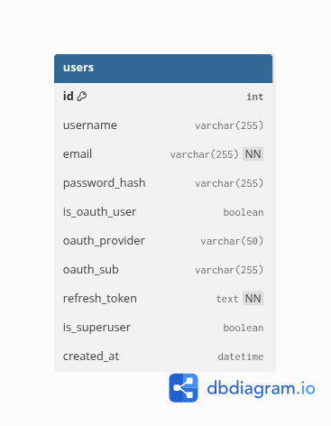

# PostgreSQL
## General view of Database

## Deployment of DB in development stage
### Credentials
ADMIN USER LOGIN
```
admin
```
ADMIN USER PASSWORD
```
admin
```
### Image creation
```
docker build -t <image-name> .  
```
### Container creation
```
docker run -d --name <container-name> -p 5432:5432 <image-name>
```
or
```
docker run -d \
  --name db-users \
  -e POSTGRES_USER=<username> \
  -e POSTGRES_PASSWORD=<password> \
  -e POSTGRES_DB=<database_name> \
  -p 5432:5432 \
  db-users-image:latest
```
### Health check
```
docker exec -it <container-name> psql -U <db-user> -d <db-name> -c "\dt"
```
