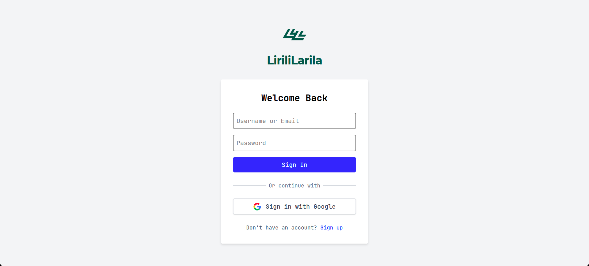
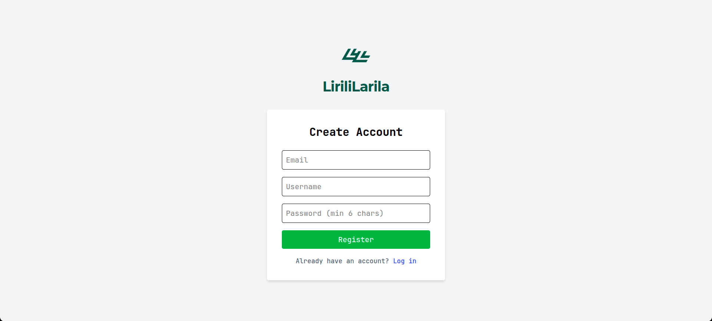
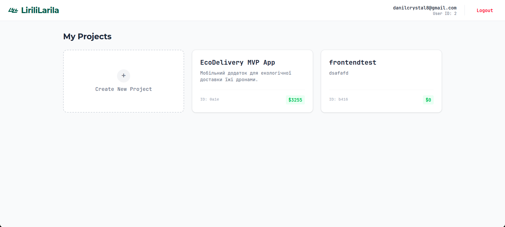
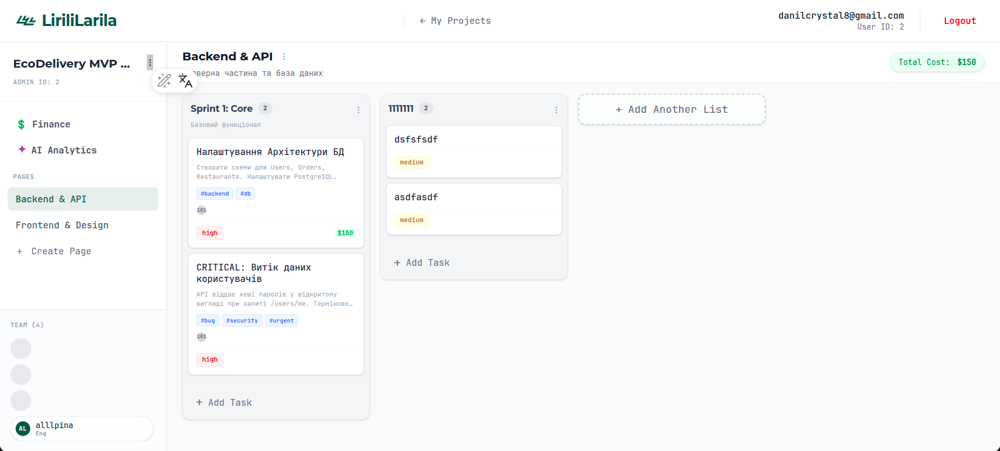
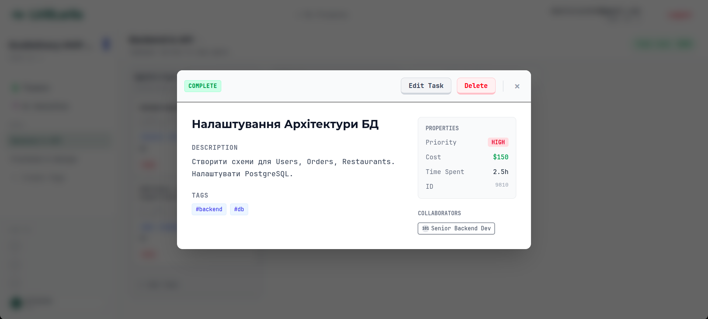
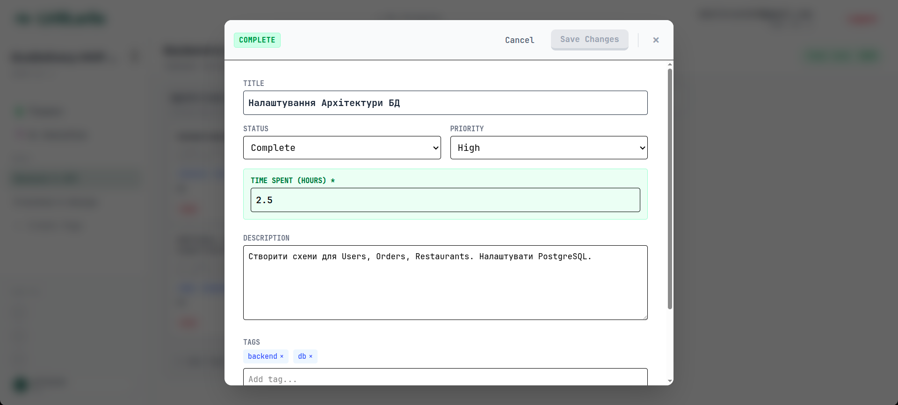
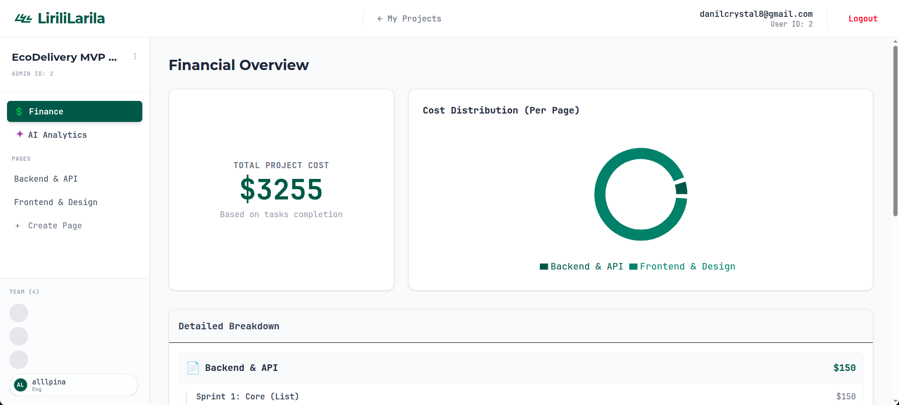
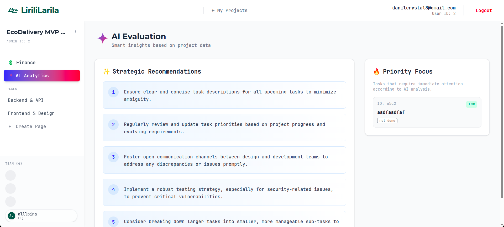

# Front-end
'Frontend' service is a Single Page Application (SPA) built with React and Vite. It provides the user interface for project management, Kanban boards, task tracking, and analytics.
## Structure
```
├── Dockerfile
├── eslint.config.js
├── index.html
├── nginx.conf
├── package.json
├── package-lock.json
├── postcss.config.js
├── public
│   ├── favicon.png
│   ├── logo.png
│   ├── logo.svg
│   └── vite.svg
├── README.md
├── src
│   ├── api
│   │   ├── axios.ts
│   │   ├── services.ts
│   │   └── socket.ts
│   ├── App.css
│   ├── App.tsx
│   ├── components
│   │   ├── Header.tsx
│   │   ├── icons
│   │   │   └── GeminiIcon.tsx
│   │   ├── Layout.tsx
│   │   ├── modals
│   │   │   ├── CreateBoardModal.tsx
│   │   │   ├── CreatePageModal.tsx
│   │   │   ├── CreateProjectModal.tsx
│   │   │   ├── CreateTaskModal.tsx
│   │   │   ├── EditBoardModal.tsx
│   │   │   ├── EditPageModal.tsx
│   │   │   ├── EditProjectModal.tsx
│   │   │   └── TaskDetailModal.tsx
│   │   └── project
│   │       ├── BoardColumn.tsx
│   │       ├── CollaboratorBadge.tsx
│   │       └── TaskCard.tsx
│   ├── context
│   │   └── AuthContext.tsx
│   ├── index.css
│   ├── main.tsx
│   ├── pages
│   │   ├── Dashboard.tsx
│   │   ├── LoginPage.tsx
│   │   ├── PageView.tsx
│   │   ├── ProjectAI.tsx
│   │   ├── ProjectFinance.tsx
│   │   ├── ProjectView.tsx
│   │   └── RegisterPage.tsx
│   └── types
│       └── index.ts
├── tailwind.config.js
├── tree.txt
├── tsconfig.app.json
├── tsconfig.json
├── tsconfig.node.json
└── vite.config.ts
```
## Dependencies:
```json
"dependencies": {
    "react": "^18.3.1",
    "react-dom": "^18.3.1",
    "react-router-dom": "^6.22.3",
    "axios": "^1.6.8",
    "@hello-pangea/dnd": "^16.6.0",
    "recharts": "^2.12.3",
    "clsx": "^2.1.0",
    "tailwind-merge": "^2.2.2"
},
"devDependencies": {
    "vite": "^5.2.0",
    "typescript": "^5.2.2",
    "tailwindcss": "^3.4.1",
    "postcss": "^8.4.35",
    "autoprefixer": "^10.4.18"
}
```

## Special attention for `NGINX`
This configuration file (`nginx.conf`) is used within the `frontend` Docker container. Its primary role is to efficiently serve the static files of the built React application and ensure correct client-side routing (SPA).
```nginx
server { # Listens on the container's internal port listen 80; 
# Path to the built React files (created during npm run build) root /usr/share/nginx/html; index index.html; 
# ========================================================= 
# SPA Routing (Single Page Application) 
# ========================================================= 
# This block is critical for React Router. 
# Since this is an SPA, all requests that do not match actual files 
# (e.g., /project/123/page/5) must be redirected to index.html, 
# so React can handle the routing on the client side. 
	location / { 
		try_files $uri $uri/ /index.html; 
	} 
# ========================================================= 
# Caching Static Assets # ========================================================= 
# Caching for JavaScript, CSS, and images to improve performance. 
# Files are cached by the browser for 1 year. 
	location ~* \.(js|css|png|jpg|jpeg|gif|ico|svg)$ { 
		expires 1y; 
		add_header Cache-Control "public, no-transform"; 
	} 
}
```
### Key Points

1. **SPA Fallback:** The directive `try_files $uri $uri/ /index.html;` prevents 404 errors when refreshing pages on deep routes. 
2. **Internal Port:** Nginx listens on port 80, which is not exposed directly to the outside world but is accessible only to the main Gateway via the Docker network.
## Key Architecture Concepts
The application uses a **Nested Route Architecture** with a centralized state management approach for real-time updates.

- **AuthContext:** Manages JWT storage (`localStorage`), user session, and global logout handling.
- **SocketService:** A singleton class that manages WebSocket connections per project. It implements the Observer pattern to notify components of updates.
- **Update Triggers:** Instead of complex state management libraries (Redux), the app uses a `globalUpdateTrigger` context. When a WebSocket event is received (`create`, `edit`, `move`, `delete`), the trigger increments, causing `useEffect` hooks in child components to re-fetch fresh data.
## User Interface & Flows

### Authentication

The entry point of the application. It handles user credentials and Google OAuth flows.

- **Login:** Accepts Username/Email and Password. On success, stores JWT in LocalStorage and redirects to Dashboard.
- **Register:** Creates a new account.
- **Google Auth:** Redirects to the [Auth service](./Actual%20services/Auth%20service.md) endpoint `/auth/google/login` and handles the callback token via URL parameters.



### Dashboard (My Projects)

The main hub where users can see all their projects and creating new ones.

- **Logic:** Fetches `[GET] /projects/my_projects`.
- **Create Project:** Opens a modal to define project name, description, and initial team members. Sends `[POST] /create_project`.


### Project View (Shell)

This is the main layout for working within a specific project. It contains the persistent **Sidebar** and the dynamic content area (`Outlet`).

- **Sidebar:**  
 - Lists all Pages within the project.
  - Displays the Project Team (Collaborators).
  - Provides navigation to **Finance** and **AI Analytics**.
 - Contains the **Project Settings (⋮)** modal for editing/deleting the project.
- **Real-time:** Establishes the WebSocket connection: `ws://.../projects/ws/{id}`.


### Kanban Board (Page View)

The core workspace. Displays Boards (Columns) and Tasks (Cards).

- **Structure:** Horizontal scrollable area containing `BoardColumn` components.
- **Drag and Drop:** Uses `@hello-pangea/dnd`.
  - Moving a task sends `[PUT] /tasks/move_task`. 
  - Optimistic UI updates are applied immediately, followed by a background server sync.  
- **Filtering:** Allows filtering tasks by tags. Clicking a tag on a card hides all tasks without that tag across all columns.
### Task Management

Tasks are the atomic units of work. The application provides two levels of interaction:

#### 1. Task Card (Minimal View)

- Displays: Name, Priority (Color-coded), Cost, Tags, Collaborators (Avatars). 
- **Interactive Elements:** 
  - **Checkboxes & Dropdowns:** Can be updated directly from the card without opening the modal.  
  - **Tags:** Clicking a tag activates the filter.  

#### 2. Task Detail Modal (Full View)

A comprehensive modal for viewing and editing all task details.

- **View Mode:** Shows all details, custom fields, and description. 
- **Edit Mode:** 
  - Change Name, Description, Status, Priority. 
  - **Custom Fields Builder:** Add/Remove/Edit fields of type: `Text`, `Checkbox`, `Deadline`, `Dropdown`.  
  - **Team:** Assign/Unassign collaborators from the project team. 
  - **Time Tracking:** Set `time_to_complete` (only available when Status is "Complete").


### Analytics

#### Finance Overview 💲

Visualizes the cost breakdown of the project based on collaborator rates and task completion.

- **Visuals:** Uses `Recharts` to render a Donut Chart showing cost distribution per Page.
- **Tree View:** Displays a hierarchical breakdown: Page -> Board -> Task -> User Cost. 



#### AI Analytics ✨

Provides smart insights generated by Gemini AI.

- **Logic:** Fetches `[GET] /get_ai_evaluation`.  
- **Features:**  
  - **Strategic Recommendations:** A list of actionable advice for the project. 
  - **Priority Focus:** A list of specific tasks that require immediate attention, enriched with their current status and details.

