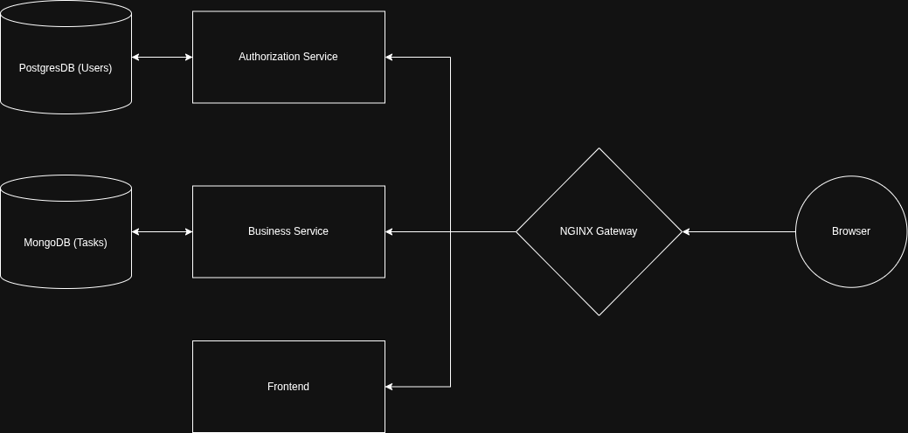

## Setup
1. Installation
```bash
git clone@github.com:allllpina/lirili-larila.git
cd lirili-larila
```
2. Environmental variables
	1) PostgreSQL, see: `./db_users/.env.example`
	2) Authorization, see: `./auth/.env.example`
	3) Business logic, see: `./tasks_mservice/.env.example`
	4) Front-end, see: `./frontend/.env.example`
	5) MongoDB - default variables, you can change in `./docker-compose.yml`
3. Run
```bash
docker-compose up # for deprecated version
# or
docker compose up # for newer version
```
4. Usage
	Visit `http:localhost:1313/`
5. Important
	You must setup your `Google Cloud Console` for authorization and requests for `Google AI`
## About
Full stack project, which includes:
- Front-end(react)
- Back-end(microservice architecture):
	- Authorization(FastAPI)
	- Business logic service(FastAPI)
- Databases:
	- Relational(PostgreSQL)
	- Non-relational(MongoDB)
- NGINX as reverse proxy
- Docker as tool for containerization
- Docker-compose as tool for clusterization
## Structure
Used services:
- [Frontend](./.md_files/Services/Front-end.md)
- [NGINX](./.md_files/Services/NGINX.md)
- [Business logic service](./.md_files/Services/Actual%20services/Tasks%20service.md)
- [Authorization service](./.md_files/Services/Actual%20services/Auth%20service.md)
- [MongoDB](./.md_files/Services/DB/Tasks%20DB.md)
- [PostgreSQL](./.md_files/Services/DB/Users%20DB.md)
- [Cluserization](./.md_files/Services/docker-compose.md)
So we got next structure for mservices:


## File structure

```
.
├── auth
│   ├── config.py
│   ├── Dockerfile
│   ├── main.py
│   ├── models
│   │   ├── auth_models.py
│   │   └── __init__.py
│   ├── requirements.txt
│   ├── routers
│   │   ├── auth_router.py
│   │   ├── __init__.py
│   │   └── user_router.py
│   └── utils
│       ├── database.py
│       ├── __init__.py
│       ├── jwt.py
│       ├── oauth.py
│       └── pwd_crypt.py
├── db_users
│   ├── Dockerfile
│   └── init.sql
├── docker-compose.yml
├── frontend
│   ├── Dockerfile
│   ├── eslint.config.js
│   ├── index.html
│   ├── nginx.conf
│   ├── package.json
│   ├── package-lock.json
│   ├── postcss.config.js
│   ├── public
│   │   ├── favicon.png
│   │   ├── logo.png
│   │   ├── logo.svg
│   │   └── vite.svg
│   ├── README.md
│   ├── src
│   │   ├── api
│   │   │   ├── axios.ts
│   │   │   ├── services.ts
│   │   │   └── socket.ts
│   │   ├── App.css
│   │   ├── App.tsx
│   │   ├── components
│   │   │   ├── Header.tsx
│   │   │   ├── icons
│   │   │   │   └── GeminiIcon.tsx
│   │   │   ├── Layout.tsx
│   │   │   ├── modals
│   │   │   │   ├── CreateBoardModal.tsx
│   │   │   │   ├── CreatePageModal.tsx
│   │   │   │   ├── CreateProjectModal.tsx
│   │   │   │   ├── CreateTaskModal.tsx
│   │   │   │   ├── EditBoardModal.tsx
│   │   │   │   ├── EditPageModal.tsx
│   │   │   │   ├── EditProjectModal.tsx
│   │   │   │   └── TaskDetailModal.tsx
│   │   │   └── project
│   │   │       ├── BoardColumn.tsx
│   │   │       ├── CollaboratorBadge.tsx
│   │   │       └── TaskCard.tsx
│   │   ├── context
│   │   │   └── AuthContext.tsx
│   │   ├── index.css
│   │   ├── main.tsx
│   │   ├── pages
│   │   │   ├── Dashboard.tsx
│   │   │   ├── LoginPage.tsx
│   │   │   ├── PageView.tsx
│   │   │   ├── ProjectAI.tsx
│   │   │   ├── ProjectFinance.tsx
│   │   │   ├── ProjectView.tsx
│   │   │   └── RegisterPage.tsx
│   │   └── types
│   │       └── index.ts
│   ├── tailwind.config.js
│   ├── tsconfig.app.json
│   ├── tsconfig.json
│   ├── tsconfig.node.json
│   └── vite.config.ts
├── nginx
│   ├── Dockerfile
│   └── nginx.conf
├── package-lock.json
├── tasks_mservice
│   ├── api
│   │   ├── dependencies.py
│   │   ├── __init__.py
│   │   ├── routers
│   │   │   ├── boards.py
│   │   │   ├── __init__.py
│   │   │   ├── pages.py
│   │   │   ├── projects.py
│   │   │   └── tasks.py
│   │   └── schemas.py
│   ├── config.py
│   ├── db
│   │   ├── database.py
│   │   ├── __init__.py
│   │   ├── models.py
│   │   └── repositories.py
│   ├── Dockerfile
│   ├── main.py
│   ├── requirements.txt
│   ├── services
│   │   ├── board_service.py
│   │   ├── exceptions.py
│   │   ├── __init__.py
│   │   ├── page_service.py
│   │   ├── project_service.py
│   │   └── task_service.py
│   └── utils
│       ├── ai_processing.py
│       ├── check_access.py
│       ├── __init__.py
│       └── websocket_hub.py
└── README.md
```